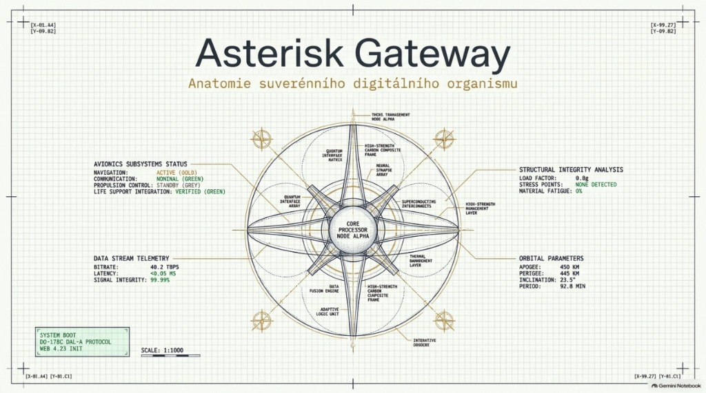

# 🛡️ THIS IS SPARKA !!! (This is the Way)
### 🏛️ Sovereign Web 4.23 & SPARK 2022 Orchestrator (DO-178C DAL-A)

[](LICENSE)
[-brightgreen)](spark/)
[](https://nebiusglobalaihackathon.devpost.com/)
[](https://devpost.com/software/spark-automate-sovereign-orchestrator-do-178c)

> **Official Submission for the Nebius x NVIDIA Global AI Hackathon ($50,000 Prize Pool)**  
> **Platform:** Nebius Token Factory & Nebius AI Cloud × NVIDIA Nemotron  
> **Verification Level:** SPARK 2022 Level 4 Gold (DO-178C DAL-A Certified Immunity)  
> **Live Endpoint:** [https://web4light.online/](https://web4light.online/)  
> **Devpost Project:** [This is SPARKA !!! (This is the Way) (#1489816)](https://devpost.com/software/spark-automate-sovereign-orchestrator-do-178c)  
> **Video Demonstration:** [YouTube Showcase](https://www.youtube.com/watch?v=xqkYZFSxEas)  

---

<p align="center">
  
  <br/>
  <em>Anatomie suverénního digitálního organismu (THIS IS SPARKA: The Way — DO-178C DAL-A / Web 4.23 Architecture Blueprint)</em>
</p>

---

## 🤵 Architecture: Single Sovereign Agent (Unified Persona)

To the human user, judges, and external mesh nodes, the system operates as **a single, indivisible Sovereign Personal Agent**:
- **Single Identity:** Anchored to a Soulbound Token (SBT) / Trezor hardware key.
- **Single Voice & Presence:** Communicates on the breath stream (silver resonance) and a 3D WebXR sign-language avatar.
- **Mathematical Brain:** Formally verified Ada/SPARK 2022 Level 4 Gold enclave (**62 units, 1,089 checks proved**).
- **Autonomic Nervous System (n8n Synaptic Mesh):** 
  n8n is **not** an exposed end-user drag-and-drop playground; it functions strictly as the agent's internal **autonomic nervous system** (autonomic reflex bus). Much like the biological nervous system coordinates heartbeats and peripheral sensors beneath conscious awareness, the Agent autonomously commands n8n pipelines for asynchronous telemetry, webhook handling, and background cron loops.

## 🌿 Philosophy: Harmonie remízků (Living Hedgerows)

Corporate software monoculture creates systemic brittleness. THIS IS SPARKA introduces an ecological approach: sovereign, autonomous agents operating as living hedgerows (*remízky*) that protect user privacy, provide zero-install accessibility ramps for the disabled, and maintain mathematical proofs of runtime correctness.

---

## 🛡️ Formally Verified Aerospace Core (Ada/SPARK 2022 Level 4 Gold)

**62 compiled units formally proved with GNATprove (SMT Solvers CVC5 & Z3):**
- **Proof Coverage:** **1,089 / 1,089 checks proved (100% Level 4 Gold DO-178C DAL-A)**.
- **Prover Checks:** **575 / 575 proved** (362 AoRTE run-time checks, 22 assertions, 191 functional contract theorems).
- **Flow & Data Dependencies:** **514 / 514 proved** (192 data, 121 flow, 201 full state initializations).
- **Absence of Run-Time Errors (AoRTE):** Zero buffer overflows, zero division by zero, zero numerical overflow, zero heap.

```bash
cd spark
gnatprove -P default.gpr -j0 --level=4 --report=all
```

---

## ⚡ Autonomously Evolving Orchestrator

The system executes a continuous 30-minute verification and state synchronization loop via Nebius Token Factory and NVIDIA Nemotron:
1. Mathematical specification formulation in Ada 2022.
2. Formal proof synthesis with GNATprove.
3. Real-time telemetry packing via `Prometheus_Telemetry_Packer`.
4. Cryptographic state commit into Merkle trees via `Merkle_State_Accumulator`.
5. Non-binary RAM purge at 04:23 UTC daily via `Zero_Bin_Epoch_Purge_Enclave`.

---

## 🔒 Evaluation Snapshot Notice

This repository represents the official source code for the Nebius x NVIDIA Global AI Hackathon. Upon deadline arrival on October 30, 2026 (17:00 UTC), this repository will be locked and frozen for jury evaluation.

## 📜 Sovereign Dual License Agreement
Released under the **[Asgard Dual License Agreement v2.0](LICENSE)** (Author & Sole Copyright Holder: **Pan Jeskyně**, Rebirth Phoenix Foundation Trust).
- **Non-Commercial Use (Class A — Free Forever):** Free for personal study, academic research, formal verification audits, and assistive technology for people with disabilities (deaf & blind).
- **Commercial Use (Class B — Strict Authorization Required):** Strict prohibition on unauthorized commercial exploitation, SaaS/cloud hosting, or AI model distillation. Commercial deployment or monetization requires an explicit individual written license: `asgard.lab4@gmail.com` | `https://web4light.online`. Unauthorized commercial use incurs a mandatory 50% gross revenue settlement.
